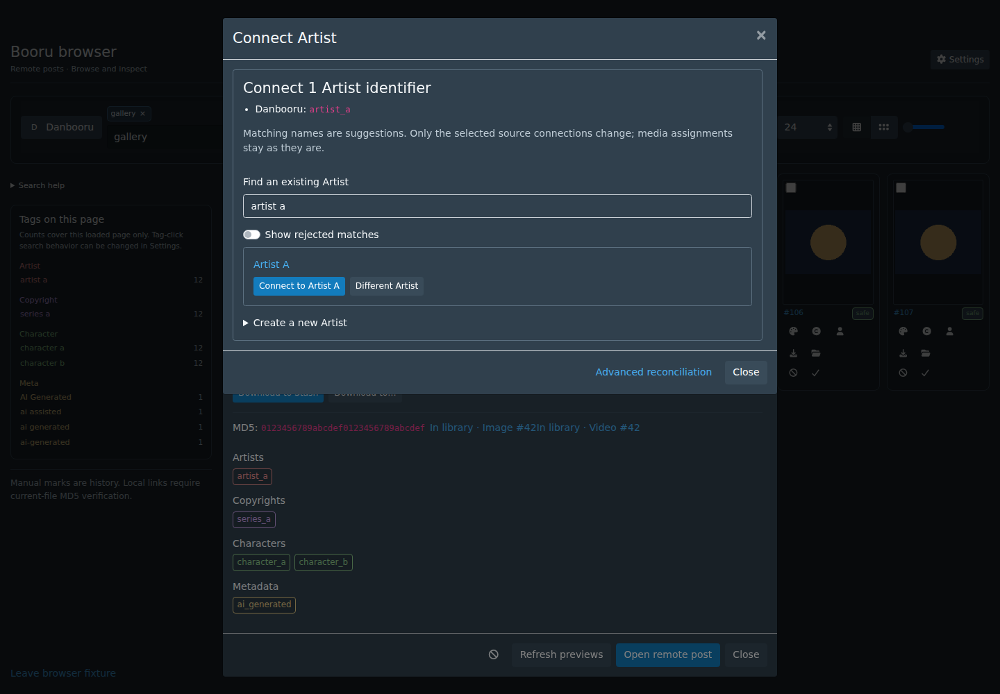
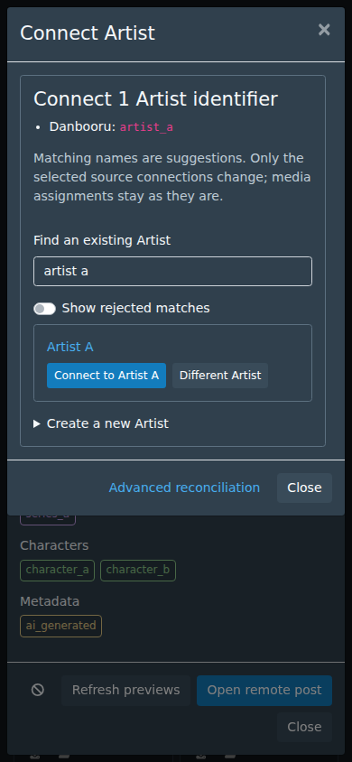

# Provider identities

This work connects provider Artist, Character and Copyright identifiers to native
StashBooru records. General tags keep their existing behavior. This first slice adds manual linking,
bulk review and local metadata discovery.

## Identity contract

One native Artist/Character/Copyright ID is the permanent local identity. Each
provider tag/account is a separate, source-scoped identifier with an exact target.
For example, after review, Rule34 `waligner`, Gelbooru `waligner_(artist)` and
Pawchive `creator:patreon:49481727` can point to one native Artist. This example
does not independently verify that those accounts belong to the same person.

Keys include the engine/URL instance, category, tag/account form and exact target.
A matching display name is not identity proof. Source aliases share a key only
when their normalized instance matches. Accounts include their service in the
provider selector, so equal numeric IDs on different services remain distinct.
Neither credentials nor signed media URLs belong in these records.

Bindings point directly to native IDs and read current names. Renaming a native
record does not break a connection. Native deletion clears the link and invalidates
outstanding decisions. Linking does not rename/delete source identifiers, append
unscoped native aliases, merge catalogue records, modify general tags or infer
Character/series hierarchy from co-occurrence.

Explicit link/unlink and rejected/allowed suggestions have version checks. Batch
decisions are all-or-nothing, limited to 100 identifiers in one category. Creating
a native record and linking selected identifiers is one transaction. A failure
leaves no partial binding or orphan newly created entity.

## First usable slice

Browse metadata is cached as unresolved provider observations, bounded to 100,000
identifiers. Refreshing those observations never overwrites a connection or
rejected candidate. Name/underscore/category-suffix normalization helps find
candidates but never automatically joins people or characters.

The **Identities** page offers linking from post identifiers, native record
creation/selection, batch decisions, remembered rejections, original identifiers
under Sources & aliases, and a scan of locally saved provider metadata. Native
Artist/Character/Copyright text searches also recognize their connected provider
identifiers while retaining native IDs, relationships and curated aliases.

Only saved download receipts and cached feed metadata can be scanned locally.
Source metadata absent from those records cannot be recovered by guessing
filenames or treating a general tag as an Artist. Live cross-provider profile
discovery, automatic media reassignment, native duplicate consolidation and
Following changes are later work.

## Using identities

1. Browse provider posts, or choose **Identities → Scan saved metadata**. Artist
   directory searches also collect readable Pawchive/Kemono creator names.
2. In a preview tag menu, choose **Connect Artist/Character/Copyright**. A dialog
   opens over the current preview, keeping its search, page and position.
   Closing it returns keyboard focus to the preview. General tags retain their
   search actions. **Advanced reconciliation** opens the existing Identities
   page for bulk work. Raw targets remain under **Sources & aliases**.
3. Choose an existing native record, or expand **Create a new…**. Character
   creation supports native disambiguation. A matching name never links itself.
4. Select several rows, or **Select matching labels on this page**, to connect
   them together. That button only selects candidates; review the selection
   before connecting. **Different…** remembers a rejected match for one identifier.
   **Show rejected matches** lets you allow it again. **Later / deselect** leaves
   identifiers unresolved. **Remove connection** reverses a binding.
5. Native profiles expose **Sources & aliases → Manage connections** in a dialog,
   without leaving the profile. **Add source name** takes an enabled site and
   its exact tag or creator expression, then shows a separate **Connect to…**
   decision for this profile. Merely reviewing a name creates no binding or native
   record. Closing cancels the decision; a local unresolved observation may remain.
   Manage a listed name to remove its connection. Moving a name from another
   profile shows its current connection before the explicit decision. Native
   catalogue text searches recognize connected source names and IDs. A fresh
   browser search displays the current canonical name while source searches use
   the exact original tag/account selector. Artist/Character text searches evaluate
   each term across all connected identifiers: exclusions such as `-foo` exclude
   the entire entity, and required terms can match different connected sources.
   Character suggestions also recognize native `Name (Disambiguation)` names.

Filters and keyset pages are represented in the URL. Mobile Review scrolls the
bulk connection panel into view. Dialogs and bulk review share the same resolver.
Stale decisions fail atomically and retain the draft and selection. **Reload
latest connections** refreshes versions without saving again; review the current
binding before retrying. A lost/error reply also requires a reload, so Create
cannot be blindly resubmitted. Close is disabled during a submitted write; closing
an idle dialog does not save a connection or create a native entity. Provider
queries and media assignments are unaffected by these connection controls.

### Contextual connection examples

Automated fixtures using the real browser preview; no live provider content.
The advanced reconciliation page remains available for bulk work.

| Desktop | Mobile |
| --- | --- |
|  |  |

## Scan limits and recovery

The job reads cached Following metadata (including historical/ignored entries)
and regular JSON download receipts of at most 64 KiB. It skips malformed, oversized,
symlinked and unverifiable-source files. It never reads downloaded media or
requests remote pages. Broken current source settings do not hide receipt source
provenance or immutable saved follow source definitions. Scans use configured or
default provider names; unavailable custom providers retain existing recorded
names, and new observations fall back to the saved source ID. User follow labels
never replace provider names.

Only one scan is queued/running per library. It has a ten-minute timeout and a
100,000-directory-entry bound. Cancel keeps previously committed observations.
Repeat scans are idempotent; progress counts observations, including repeated
identifiers, rather than newly created identities. Status is in memory and resets
on restart; connections and explicit decisions remain in SQLite. Cancellation
through Stash’s native job queue is also reflected in scan status. Explicit
cancellation finishes as cancelled in the native Jobs UI; a timeout is a failure. A restart or
cancel resumes by rescanning, rather than through a persisted file cursor.

The global identity cache holds at most 100,000 entries. Existing connections
remain visible when new observations cannot fit. **About the saved metadata scan
→ Discard unreviewed…** removes only untouched unresolved metadata in the chosen
category, preserving all bindings and explicit decisions. A later browse/scan
can rediscover discarded observations. Unknown metadata cannot be reconstructed
from filenames. The scan does not reassign media or consolidate duplicate native
records; those are separate follow-up work.

## API

All routes use normal server authentication, JSON/origin bounds for mutations and
no-store responses.

- `GET /identities/list`: category, unresolved/linked state, text, native entity
  or exact identity filters; stable keyset pages of 50.
- `GET /identities/candidates`: bounded native names/aliases/connected identifiers,
  with Character disambiguation and explicit optional rejected matches.
- `POST /identities/update`: observe, link, unlink, create, reject, restore or discard.
  Decisions include identity IDs and current versions; native targets are typed.
- `GET/POST /identities/scan`: current status and idempotent start/cancel through
  the native job queue. Cancellation includes the current job ID.

Migration 100 adds observations/bindings and rejected suggestions. It does not
rewrite existing media, native entities, general tags or follow intent.
